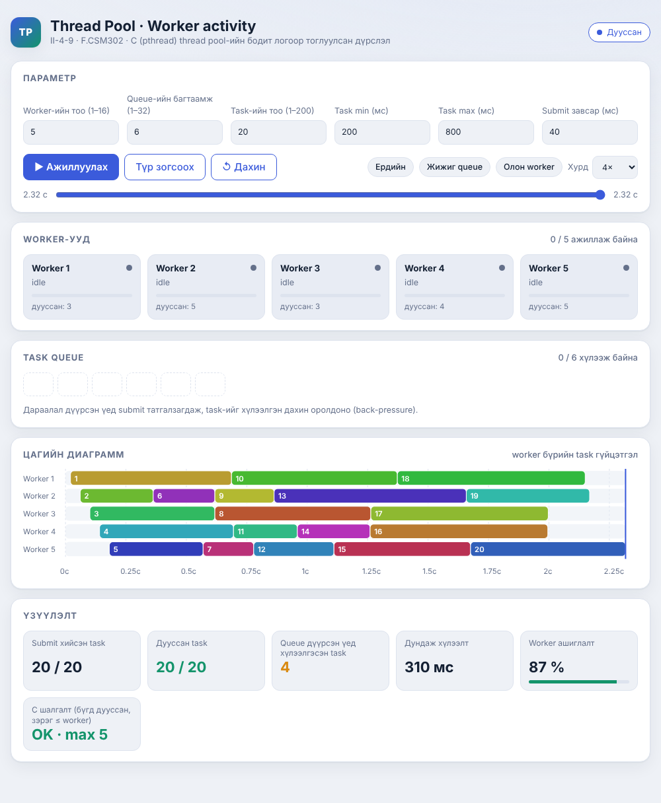
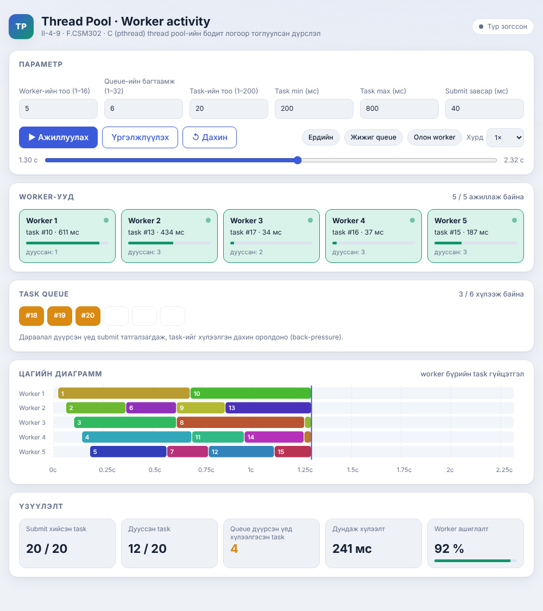
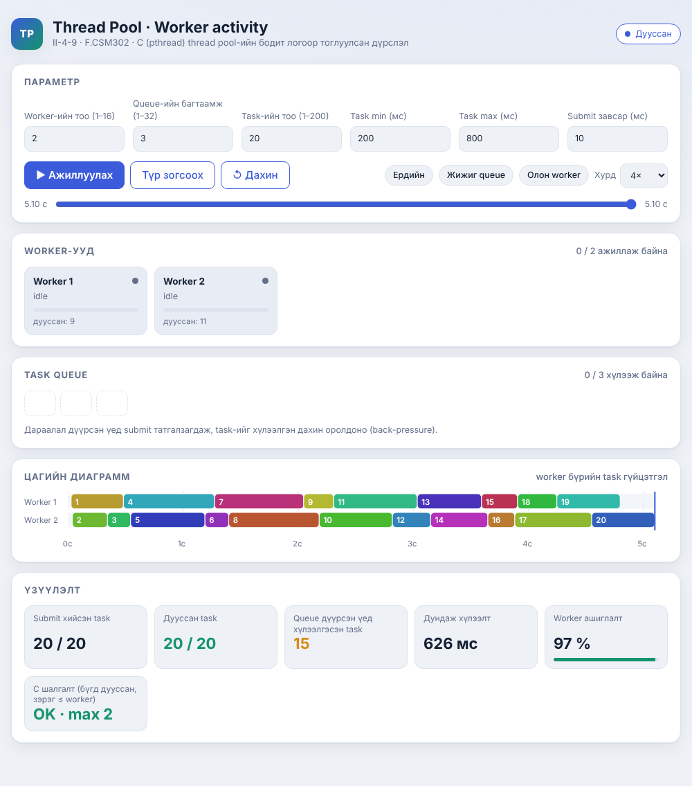
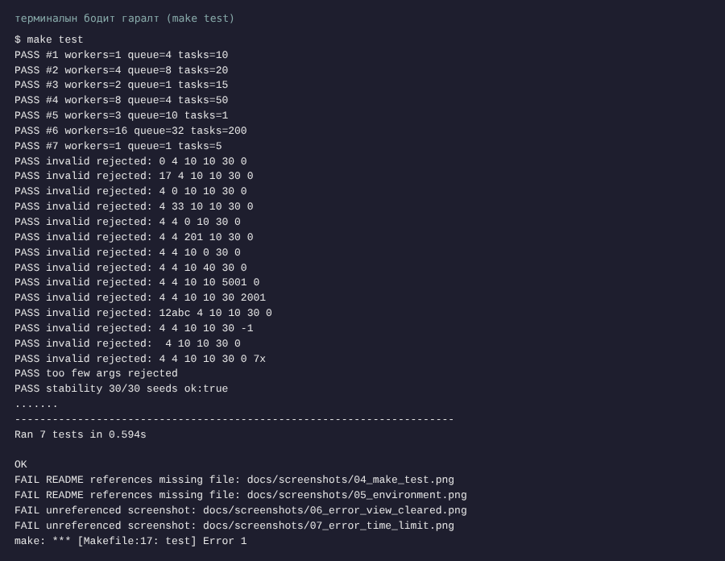
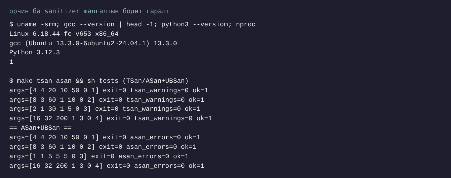
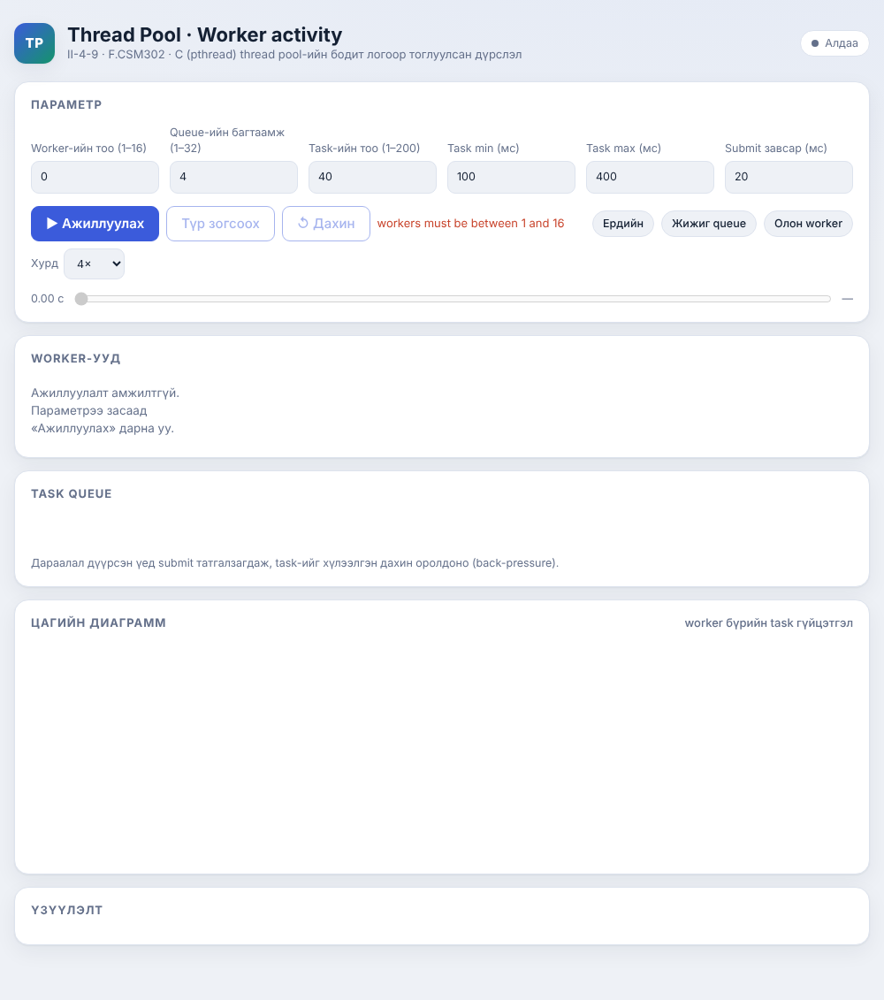
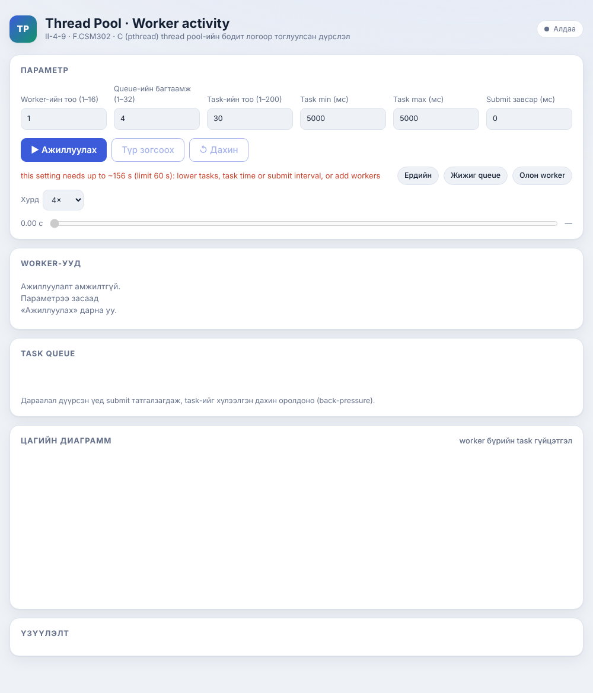

# II-4-9 · Designing a Thread Pool (Final, v1.0-final)

F.CSM302 Үйлдлийн систем · Бие даалт 1 · Сэдэв 9 (Synchronization Examples, Operating System Concepts)
UI дүрслэл: **Worker activity**

Баг: B222270042, B232270097, B241940004, B241960045, B242270073

## Товч тайлбар
POSIX thread (pthread) ашигласан thread pool-ийг C хэлээр хэрэгжүүлсэн. Pool нь ажиллах явцдаа
submit / start / done / idle / rejected үйл явдлуудыг бүртгэнэ. Вэб UI нь тэр бодит логийг хугацаагаар нь
сэргээн тоглуулж, worker бүрийн төлөв (idle/running), task queue, цагийн диаграммыг харуулна.

## Бүтэц
| Файл | Үүрэг |
|---|---|
| `src/threadpool.h/.c` | Thread pool: `pool_init`, `pool_submit`, `pool_shutdown` |
| `src/tpdemo.c` | Pool-ийг ажиллуулж, JSON логийг stdout руу хэвлэнэ |
| `serve.py` | UI-г үйлчилж, параметрээр `tpdemo`-г ажиллуулна (зөвхөн Python 3 стандарт сан) |
| `ui/index.html` | Интерактив UI |
| `tests/run_tests.sh` | Автомат тест |

## Quick Start
Шаардлага: `gcc` эсвэл `clang`, GNU `make`, Python 3 (≥3.8, зөвхөн стандарт сан), орчин үеийн хөтөч.
```
make              # tpdemo build (анхааруулгагүй)
make test         # бүх автомат тест (C тест + serve.py тест + баримтын шалгалт)
python3 serve.py  # http://localhost:8000
```
Хөтчөөр http://localhost:8000 нээгээд «Ердийн» товчийг дарна. CLI: `./tpdemo 8 4 40 100 400 20 1` (JSON гаралт)
Нэмэлт: `make bench` (worker scaling), `make tsan` / `make asan` (Linux), `make clean`.
Дэлгэрэнгүй: `docs/Manual.pdf`. Release: `v1.0-final`.

## Дэмжигдэх орчин
| Орчин | Төлөв |
|---|---|
| Linux (Ubuntu 24.04, gcc 13.3, Python 3.12) | БД2 засварын үеийн туршилт: build анхааруулгагүй, `make test`, `make bench`, TSan, ASan/UBSan |
| macOS 26 arm64, Apple clang 17, Python 3.9 | V-1-4 багийн шүүмжид build, `make test`, 30 давталт амжилттай. `make tsan` хөрвүүлэгдэх ч Apple clang-ийн хязгаарлалтаас ажиллахгүй, TSan-ийг Linux дээр ажиллуулна |
| Windows | Шууд ажиллахгүй, WSL2 (Ubuntu) ашиглана |

## Thread pool-ийн дизайн
- Дараалал нь хязгаартай circular buffer (`queue`, `head`, `tail`, `count`).
- Нэг mutex дараалал болон shutdown флагийг хамгаална; `not_empty` condition variable-ээр worker-ууд хүлээнэ.
- `pool_submit` дараалал дүүрсэн бол task-ийг авахгүй, `1` буцаана (UI дээр "татгалзал" болж харагдана).
- Task-ийг mutex-ийн гадна ажиллуулдаг тул олон worker зэрэг ажиллана.
- `pool_shutdown` дараалалд үлдсэн бүх task дуусахыг хүлээж, worker-уудыг `join` хийнэ.

## Параметр
workers 1–16, queue 1–32, tasks 1–200, task хугацаа 1–5000 мс, submit завсар 0–2000 мс.
Бүхэл тоо байх ёстой (`12abc` гэх мэт оролтыг CLI татгалзана). Буруу утга: CLI `invalid parameters`, exit 1; сервер 400 + JSON алдаа.
**Ажиллах хугацааны хязгаар:** сервер ажиллуулалтын хамгийн муу хугацааг `tasks·interval + (tasks·max/workers + max)` томьёогоор тооцож,
60 секундээс давбал ажиллуулалгүй 400 алдаа буцаана (жишээ нь 1 worker, 30 task × 5000 мс).

## JSON гаралт
Мөр бүр `{"t":мс,"e":үйл явдал,"w":worker,"k":task}`; `w = -1` бол worker-т хамаарахгүй (submit, rejected).
`summary`: `completed, max_running, rejected_tasks, total_ms` (UI-ийн цагийн тэнхлэг), `run_ms` (эхний submit-аас pool зогстол, эхлүүлэлтгүй),
`dropped_events`, `truncated`, `ok` (бүгд дууссан ∧ max_running ≤ workers ∧ үйл явдал алдагдаагүй).

## Тест
`make test` нь: 7 хэвийн тохиргоо (хязгаарын утгууд орно), 14 буруу оролт, 30 seed-ийн тогтвортой байдал, task бүрийн татгалзал нэг л удаа бүртгэгдэх,
`serve.py`-ийн 7 тест (хугацааны хязгаар орно), README-ийн зургийн холбоосын шалгалт.
Test бүр "бүх task дууссан, `done` лог task бүрт, зэрэг ажилласан worker ≤ worker-ийн тоо, үйл явдал алдагдаагүй" гэдгийг шалгана.

## Дэлгэцийн зураг
Бүх зургийг жинхэнэ `serve.py` + `tpdemo`-г Chromium дээр ажиллуулж авсан. Орчин: `docs/screenshots/05_environment.png`.

**1. Бүх task дууссан** (5 worker, queue 6, 20 task, submit завсар 40 мс).


**2. Ажиллаж байх үе** (1.3 с): queue дүүрсэн, worker бүгд ажиллаж байна.


**3. Жижиг queue** (2 worker, queue 3, 20 task, завсар 10 мс): back-pressure.


**4. Автомат тест** (`make test`).


**5. Орчин ба sanitizer** (TSan, ASan+UBSan).


**6. Алдааны дараа дүрслэл цэвэрлэгдэнэ** (workers=0, шүүмж R2).


**7. Хэт удаан тохиргоо урьдчилан татгалзагдана** (шүүмж R1).


## Known issues
- Task нь `usleep`-ээр симуляц хийсэн ажил; бодит тооцоолол биш.
- `tpdemo` нь нэг submit thread-тэй; татгалзсан task-ийг `usleep(3000)`-аар дахин оролддог (pool-ийн `pool_submit` нь стандартын дагуу блоклодоггүй).
- Log буфер дүүрвэл `truncated: true` болж UI «ЛОГ ДҮҮРСЭН» гэж харуулна (одоогийн хэмжээ бүх зөвшөөрөгдсөн тохиргоонд хүрэлцдэг).
- ThreadSanitizer macOS (Apple clang) дээр ажиллахгүй, Linux дээр ажиллуулна.

## Ашигласан материал
- Silberschatz et al., *Operating System Concepts* (2018), Programming Projects: Designing a Thread Pool.
- AI ашигласан: Claude (Anthropic). Кодын анхны хувилбар, UI болон README-ийн ноорогийг AI-аар үүсгэсэн.
  Баг кодыг өөрсдөө build/run хийж, тестлэж, screenshot-оор илэрсэн алдааг (лог буфер дүүрч үйл явдал алдагддаг байсан) засуулсан.
  БД2-ын засваруудыг V-1-4 багийн албан ёсны шүүмжид үндэслэн хийсэн (`docs/Final_Report.pdf` §4).
